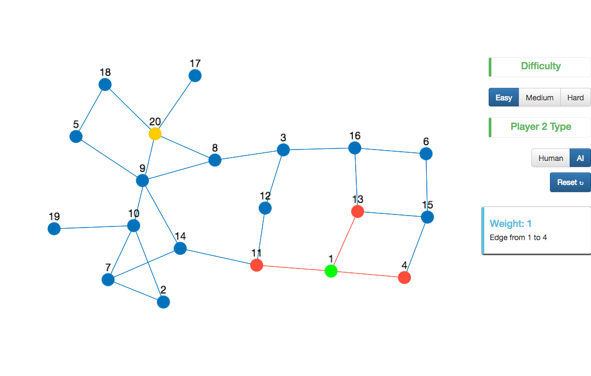

+++
title="Adversarial Shortest Path"

[extra]
team="Team Jeopardy"
thumbnail="thumbnail.png"
+++

<h3>Instruction:</h3>

- Player's current position is displayed as 'Green' and destination as 'Yellow'.

- In each turn Player can move to any connecting node, represented by 'Red'.

- Player's goal is to reach destination by travelling minimum cost path.

- In each turn Adversary can double the cost of any edge.

- Hover over an edge to display its current cost.

In each game you play two roles, first as 'player' then as 'adversary'. Whoever uses smaller cost path from source to destination is the winner.

<h4>Screenshot:</h4>
</img>
