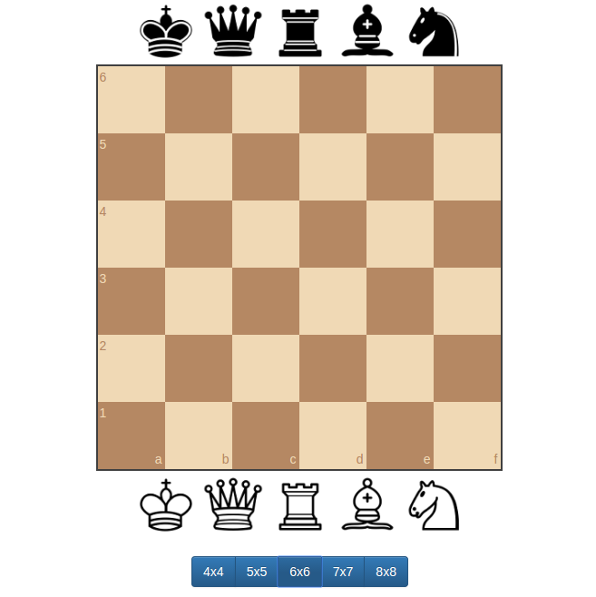

+++
title="Corner Chess"

[extra]
team="Team Longnames"
thumbnail="thumbnail.png"
+++

<h3>Rules</h3>
<ul class="list-group">
    <li class="list-group-item">
    At each ply, the player can either bring a new piece into play, 
    or move an existing piece in the board.
    </li>
    <li class="list-group-item">
    The first move for each player (white and black), must be bringing the King into play.
    </li>
    <li class="list-group-item">
    Pieces being brought into play cannot be placed over an existing piece.
    </li>
    <li class="list-group-item">
    White can only check black after black has checked or at ply 4 (whichever is earlier).
    </li>
    <li class="list-group-item">
    Black cannot check white before ply 2.
    </li>
</ul>

