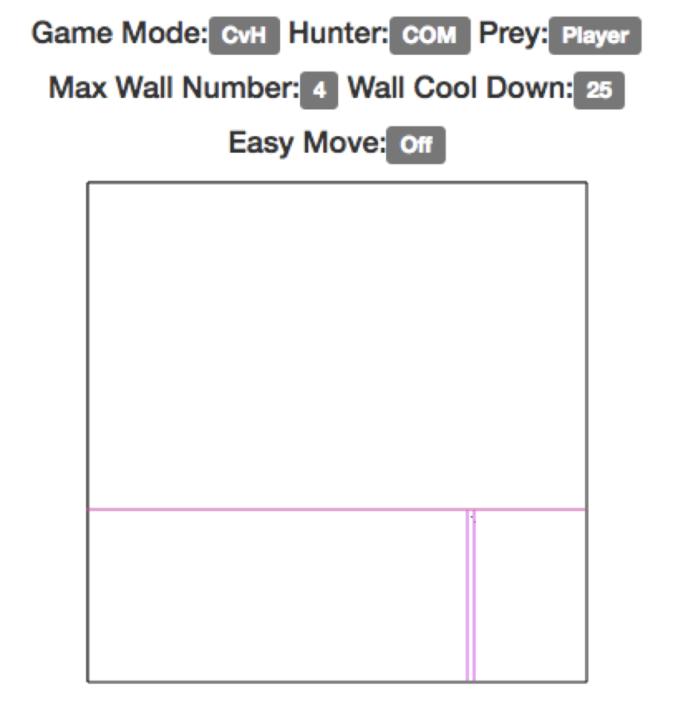

+++
title="Evasion"

[extra]
team="Demented Banana"
thumbnail="thumbnail.png"
+++

<h3>Instruction:</h3>

- The Red marker in our game is the hunter, while the Green one is the prey. Your goal as a hunter is to catch the prey as soon as possible by building walls to let yourself bouncing around, while your goal as a prey is to avoid being caught as long as possible. The game won't stop until the hunter catches the prey.

<h3>Rules of the game:</h3>
<ul>
<li> Rule #1: The hunter moves twice as fast as the prey, but it changes direction only by bouncing off a wall, which means you cannot control the moves of it.</li>
<li> Rule #2: The prey, on the other hand, can move in whichever direction it wants provided it doesn't pass through a wall.</li>
<li> Rule #3: The hunter catches the prey by building horizontal and vertical walls as its current position to get close to the prey and trap it.</li>
<li> Rule #4: You can specify the number of walls that the hunter can build(N) and the time interval between building consecutive walls(W).</li>
</ul>

<h4>Screenshot:</h4>
</img>