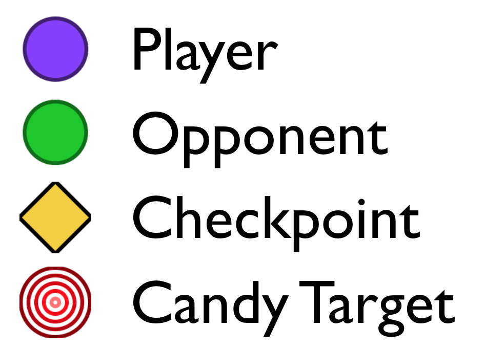
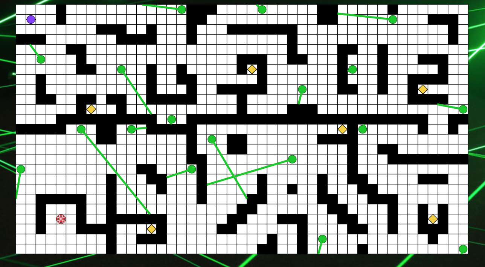

+++
title="Candy Heist"

[extra]
team="Team git_lost!"
thumbnail="thumbnail.png"
+++

<b>Game and Objective</b>
 
Move the player through the maze to reach the target, where an omniheurist professor is keeping a large stash of candy!
Try to avoid all opponents and laser lights while navigating through the maze.
If you are hit by an opponent or laser light, you will be reset to the nearest checkpoint.
The quicker you can reach the target, the better!

<b>How To Play</b>
 
Use the arrow keys to move the player up, down, left, or right through the empty squares of the maze.

<b>Legend</b>
 

<b>Screenshot</b>
 

    