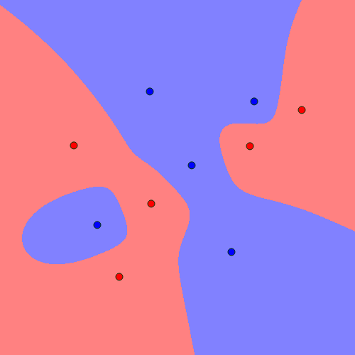
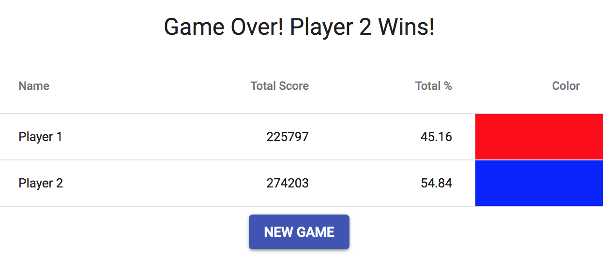

+++
title="Weighted Voronoi"

[extra]
team="Botty McBotFace"
thumbnail="thumbnail.png"
+++

Click the "?" icon in-game for instructions. 

Use the popup display and maximize it for the best experience.

<h2>Rules of the Game</h2>

<h2>Overview:</h2>

Given a set of point-sized stones of various colors,
a Weighted Voronoi diagram is a tesselation of a plane into colored regions
such that every point with integer coordinates (x, y) has the color of the stones that
give it the greatest pull.

<h2>Playing a Round:</h2>

Graviational Voronoi is a n player game that works as follows:

<ul>
<li>
n players are each assigned a color, and are each allocated W units of weight
</li>
<li>
Each player can distribute their allotted weight across a maximum of S stones on a 500x500 board.
</li>
<li>
The first player places one stone, then the second player places one stone and so on...
</li>
<li>
Each player places one stone until all players have placed S stones or have exhausted all their weight.
</li>
<li>
If a player cannot place a stone (either they have used all of their weight or placed all of their stones),
their turn is skipped
</li>
<li>
Additionally, every stone must be a Euclidean distance of at least d units
away from any other stone.
</li>
</ul>

n, S, W, and d are set at the beginning of every game.

The winner of a round is the player with the most controlled area at the end of the round.

<h2>Ending a Game:</h2>

<ul>
<li>
If there are n players, the game runs for a total of n rounds, allowing each player to go first.
</li>
<li>
At the end of the game (after n rounds), each players' scores over all rounds are summed.
</li>
<li>
The player with the highest combined score over all n rounds is declared the winner!
</li>
</ul>

<h2>Pull Calculation:</h2>

The pull for a color c at point p with coordinates (x, y) is calculated as follows:

Supposing that color c has k stones placed:

<ul>
<li>
Take all k stones and compute their Euclidean distances to point p
say d1, d2, ... dk.
</li>
<li>
Take the weights of all k stones w1, ..., wk
</li>
<li>
pull(c, p) = (w/(d1*d1)) + (w/(d2*d2)) + ... + (w/(dk*dk)).
</li>
</ul>

It's as if we're computing the color of a point based on the color that gives
the greatest pull.

