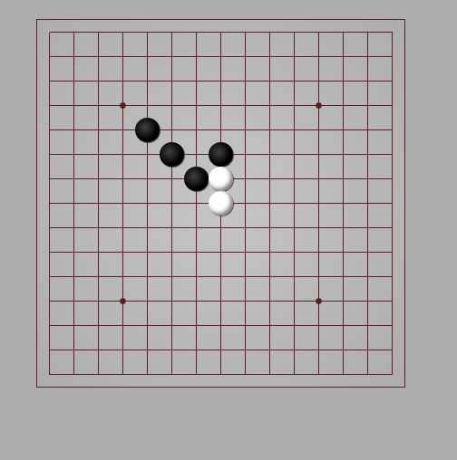

+++
title="Gomoku (2020)"

[extra]
team="Unravel"
thumbnail="thumbnail.png"
+++
<h3>Instruction:</h3>

 Goal: Place five stones consecutively horizontally, vertically or diagonally.
    Black goes first. After white places the fourth stone on the board (which has 2 black and 2 white), black will place two stones.
    White will remove one black stone, then place one white stone. The game continues by placing one stone of the alternating color.
    The first player who gets five stones consecutively will win.

</img>
