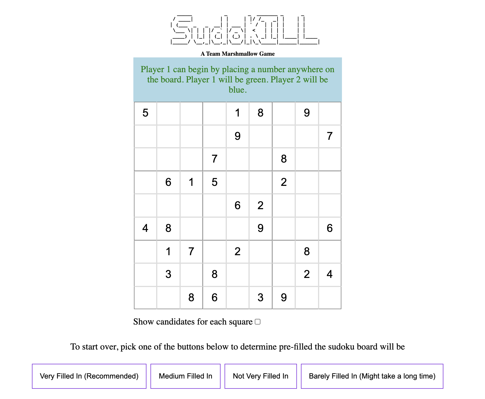

+++
title="Sudokill"

[extra]
team="team Marshmallow, Fall 2020"
thumbnail="thumbnail.png"
+++

<h3>Instructions:</h3>

 This is a 2-player twist on the classic sudoku game. 

 If you do not know how to solve a sudoku puzzle, or need a refresher, please read these rules:
<a href="https://www.learn-sudoku.com/sudoku-rules.html">learn-sudoku.com</a> 

 <strong> Rules </strong>
<ul>
<li> You are given the standard Sudoku board. There is an initial layout of numbers that violates no constraints. </li>
<li> Players alternate in placing numbers on the board, always trying to avoid violating the constraints. </li>
<li> The first player may begin by playing in any unoccupied space.  </li>
<li> After this, each player must play in an unoccupied space in either the same row or the same column as the last move (unless there are no such squares at all in which case that player may play anywhere). </li>
<li> The first player to make a move that violates the Sudoku rules loses. </li>
</ul>
 

 Press pop-up to access game window. To begin: Player 1 should simply input a number into one of the squares

<h4>Screenshot:</h4>
</img>

