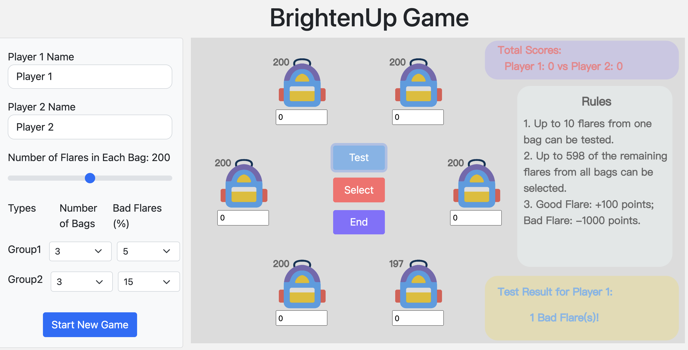

+++
title="Brighten Up"

[extra]
team="Coco_11 (Yuwen Li, Yiyi Tong)"
thumbnail="thumbnail.png"
+++

<h3>Instruction:</h3>

 The Brighten Up game is a two person game. In this game, you are given <strong> m </strong> bags each with <strong> n </strong> flares, which can be good or bad. Bags are divided into two groups, and bags in group2 have significantly more bad flares than bags in group1. You can set the number of bags in each group, but you do not know which bags belong to which groups. Each turn, you can perform one of two operations as follows: 

 <strong> Test: </strong> The player can test up to 5% of <strong> n </strong> flares from one bag. Then, the number of bad flares will be shown.

 <strong> Select: </strong> The player can select up to 50% of the remaining flares from all bags. Then, his/her score for this selection will be calculated based on the number of good flares and bad flares in the selection. The player can get 100 from each of the good flares, but each of the bad flares will cost -1000.

 <strong> Instructions </strong> 
    
 - Press pop-up to access game window. 

    
 - When it is your turn, fill in the number you want to test/select under the bag, then click "Test"/"Select" at the bottom. When you do not want to take actions anymore, click "End" to end your operations. 

 <strong> Note: </strong> For best experience, maximize window as much as possible. 

</img>
