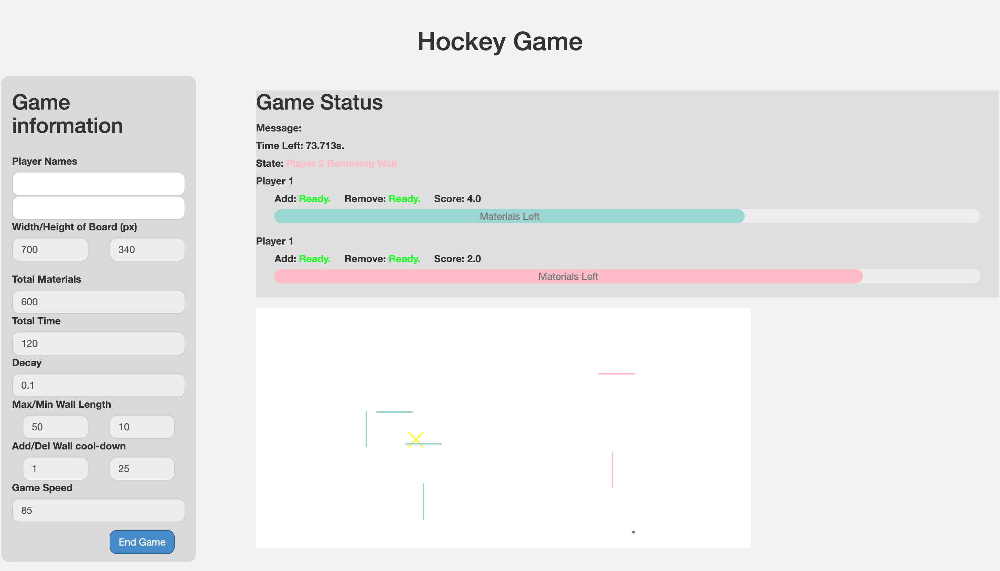

+++
title="Hockey"

[extra]
team="Bill Sun (ys3540)"
thumbnail="thumbnail.png"
+++

 In this game, you play Hockey. The puck starts at the center of the map, and you build 
walls to bounce it around. Whenever it bounces on the left/right 
border of the map, the opposing player gets one point.
You can also build walls to prevent the puck from hitting your wall. However, you only have limited materials to build walls. You may salvage materials by destroying your 
opponent's walls. You may build a wall every t1 time and destroy your opponent's wall every 
t2 time. The walls you build should have length between lmin &lt; l &lt; lmax.

  

<strong>Game Play:</strong>

Press <strong>z</strong> to change wall directions. You can only delete your opponent's wall. 
To delete a wall, press <strong>d</strong> or <strong>x</strong> on <strong>your side</strong> of the map and when the 
cursor becomes a cross, move the cursor to <strong>your opponent's side</strong> 
and click a wall highlighted in yellow to delete it. You can't delete a wall when your delete 
action is on cooldown (The time left in cooldown shows in the status panel). Press d or x again 
to exit delete mode without deleting a wall. 
Use the scroll wheel or pinch on the game board or use +/- keys to change wall lengths. (You may need to press 'o' or click on the 
Scroll button to disable scrolling before you use the scroll wheel. Press/click again to re-enable scrolling.)

    

<strong>Single Player:</strong>
    In single-player mode, whenever the puck hits the vertical boundary, you lose a point. 
    The objective is to minimize the times that the puck hits the vertical boundaries.  

<strong>vs AI:</strong> This is a demonstration of the multiplayer game, in this case you will be the left player, 
the bot will play on the right.  

<strong>Multiplayer:</strong> In order to make it more comfortable for two players to share a single keyboard, 
    You can select 'Separate Control' option. The key binding for Separate Control mode is:    
    Player 1: Toggle Delete: "d"/"x" Change Wall Direction: "z" Zoom In: "2" Zoom Out: "1" 
    Player 2: Toggle Delete: "k"/"," Change Wall Direction: "." Zoom In: "-" Zoom Out: "+" 

The game will stop after Tmax seconds. 

</img>
    