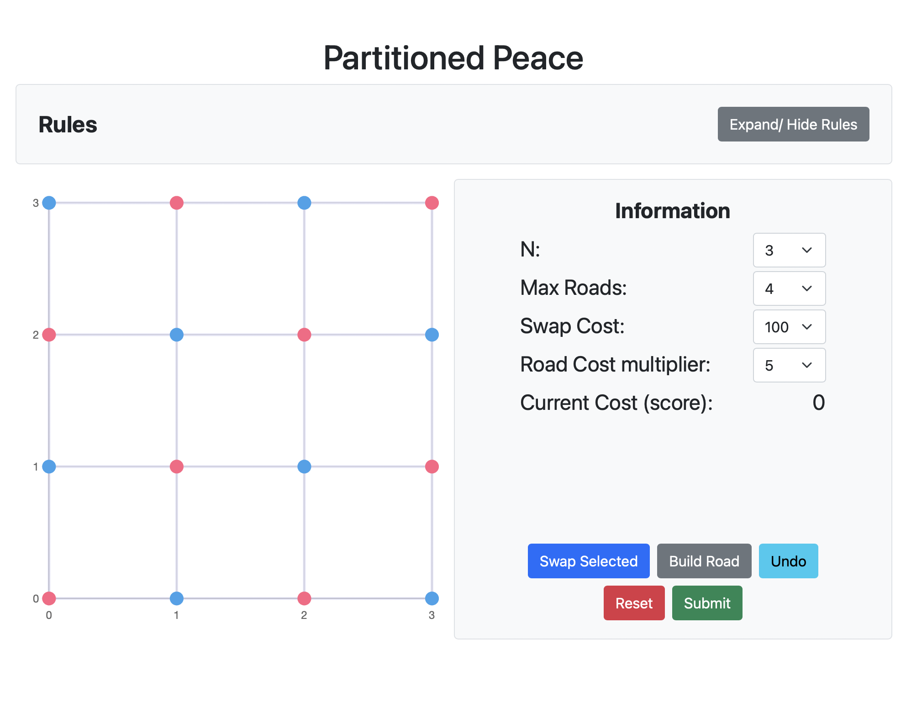

+++
title="Partitioned Peace"

[extra]
team="Team Omniheurist (Deep Mehta and Yajur Ahuja)"
thumbnail="thumbnail.png"
+++

<strong>Overview:</strong>  

In a peaceful city, there are 2 civilized communities, <strong>red</strong> and <strong>blue</strong>. People participate in all of the events held by their community and have a great time. They like their communities so much that they have painted their houses based on their community color.
    However awesome these communities may be, there is a long rivalry amongst them. The rivalry is so intense that if a person from the blue community is spotted anywhere near a red house, things get messy.
    In order to avoid a fight, the smart leaders of both the communities have decided to relocate the houses and change the existing layout of the roads such that everyone from a red house can visit all other red houses without going through a blue house; and similarly for blue.
    To successfully achieve this task within a specified budget, the leaders have hired you for the job. 

<strong>Rules:</strong>  
<ul>
    <li>Given a N x N grid of alternating colored houses, you have to come up with a minimum cost solution such that all red houses can reach other red houses without needing to cross a blue house and similarly for blue.</li>
    <li>To achieve this, you have the following options:
        <ol>
            <li>Build a new road between 2 houses (the road can be a bridge – i.e. it can go on top of other roads, but NOT intersect) </li>
            <li>Swap 2 houses</li>
        </ol>
    </li>
    <li>Your score (cost) is calculated by:
        <ul>
            <li>The cost of building a new road is the Manhattan distance between houses you want to connect by building the road </li>
            <li>Each house swap costs s, which will be significantly higher than building a new road</li>
            <li>The total cost is calculated as: Sum of all road costs + Number of swaps * cost of 1 swap </li>
        </ul>
    </li>
    <li>There is also a maximum limit to how many roads you can create</li>
</ul>

    
