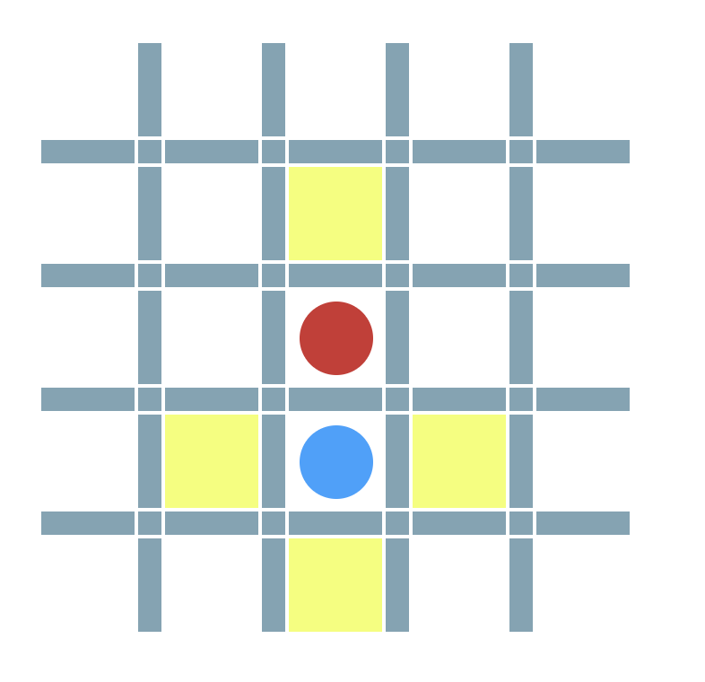
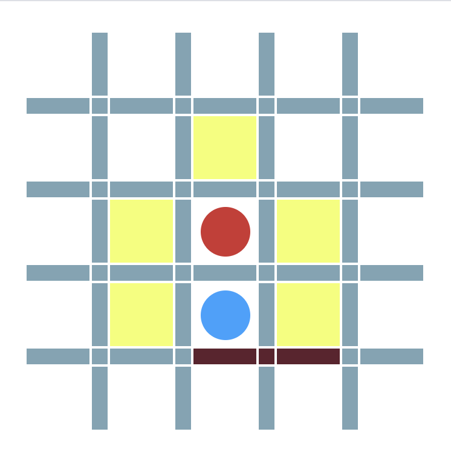
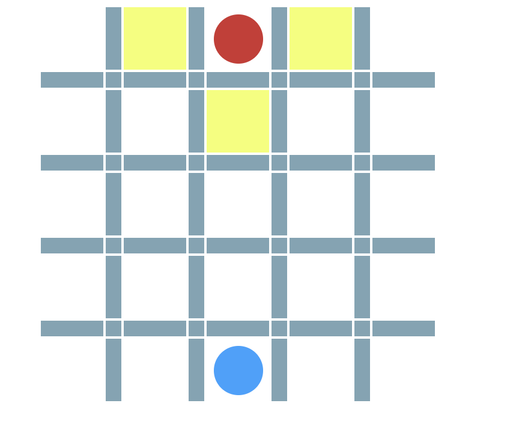

+++
title="Quoridor"

[extra]
team="Team Z (Tianbo Jiang, Chenhao Zuo)"
thumbnail="thumbnail.png"
+++

<h3>Instruction:</h3>

<strong>Overview:</strong>  

 Quoridor is played on a game board of (M X N) square spaces.
Each player is represented by a pawn which begins at the center space of one edge of the board.
The objective is to be the first player to move their pawn to any space on the opposite side of the game board from which it begins.

<strong>Walls:</strong>  

Each player starts with K walls. Walls are flat two-space-wide pieces which can be placed in the groove that runs between the spaces. 
Walls block the path of all pawns, which must go around them. 
The walls are divided equally among the players at the start of the game, and once placed, cannot be moved or removed. 
On a turn, a player may either move their pawn, or, if possible, place a wall.
Walls can be placed directly between two spaces, in any groove not already occupied by a wall. However, a wall may not be placed which cuts off the only remaining path of any pawn to the side of the board it must reach.

<strong>Movement</strong>  

Pawns can be moved to any space at a right angle (but not diagonally). 
If adjacent to another pawn, the pawn may jump over that pawn. 

In this situation, the blue pawn can jump over the red pawn.
 

 If an adjacent pawn has a wall on the other side of it, the player may move to either space that is immediately adjacent (left or right) to the first pawn. 
Walls may not be jumped, including when moving laterally due to a wall being behind a jumped pawn.

In this situation, the red pawn cannot jump over the blue pawn because there is a wall, but the red pawn can jump to the left or right to the blue pawn.
 

The first player to move their pawn to any space on the opposite side of the game board from which it begins win the game 

<h3>How to play</h3>

Choose your settings of the game (board size and number of walls) and press start to start a new game.

When it is your turn, you have two options.

**One**: Move your pawn. You click your pawn, and all possible moves are shown on the board by yellow boxes. Then, click the yellow box you want to move to.

**Two**: Build a wall. If you want to build a wall, you can move the mouse to one of the edges to preview the wall to be built, then click the mouse to build the wall.