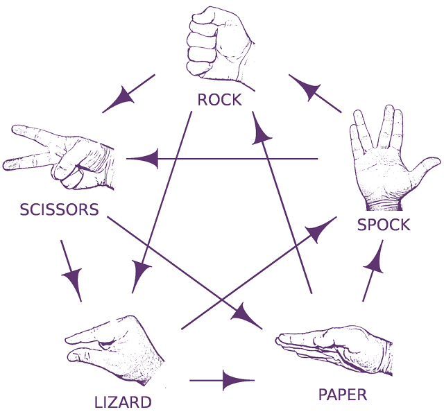

+++
title="The honorable Rock Paper Scissors"

[extra]
team="U Go Girl"
thumbnail="thumbnail.PNG"
+++

<h2 id="the-honorable-rock-paper-scissors">The honorable Rock Paper Scissors</h2>

💎📄✂️🦎🖖🏻

<h3 id="difficulty-selection">Difficulty Selection</h3>
<ul>
<li>

Easy mode - Basic Rock Paper Scissors 💎📄✂️

</li>
<li>

Hard mode- Rock Paper Scissors Lizard Spock💎📄✂️🦎🖖🏻

<blockquote>

This version is inspired by the 'Rock-Paper-Scissors-Lizard-Spock' game popularized in <em>The Big Bang Theory</em>. This game is for educational and non-commercial purposes only.

</blockquote>

The rule of Rock Paper Scissors Lizard Spock is below:

</li>
</ul>

Each round is played in two phases.

In <strong>phase 1</strong>, each player will claim an item. Their claims will stay on the screen.

In <strong>phase 2</strong>, each player P selects an item. If the player chooses the item that P previously claimed, then P will get one point. In addition, if one player's item beats the item of the other player, then that player will get two points and the loser will lose one point. Thus, a player P could gain three points in a round by being
consistent with P's claim and by having an item that beats that of the opponent.

